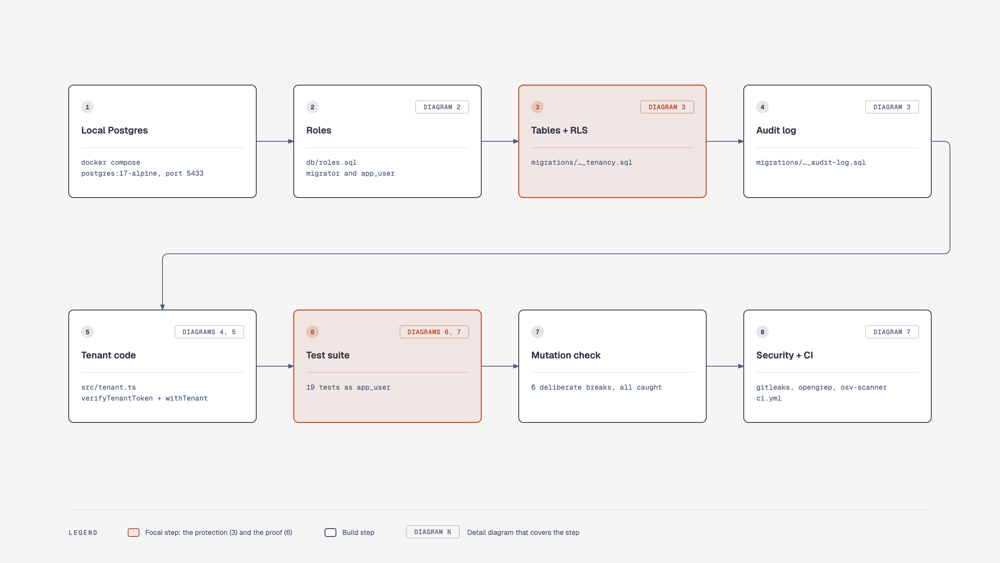

# pg-fail-closed-tenancy

[](https://github.com/ncardonab/pg-fail-closed-tenancy/actions/workflows/ci.yml)

Postgres row-level security that fails closed, an append-only audit trail, and an integration test suite that proves both while connected as the real application role.

## The problem

Multi-tenant apps that keep every customer in one Postgres database usually filter by organization in application code. One query that forgets the filter returns another customer's data.

Row-level security (RLS) moves that filter into the database. It comes with its own traps:

- **Tests that prove nothing.** Superusers and table owners skip RLS by default. A suite that connects as either one stays green while isolation is broken.
- **Leaks through the connection pool.** A tenant setting that outlives its transaction rides along to the next request that borrows the same connection.
- **Unset context.** On a reused connection, an unset setting reads back as an empty string. Depending on how the policy is written, that either throws or, in the "no tenant means admin" style, shows every row.
- **Audit gaps.** Audit rows written by application code can be skipped by a new code path, edited later, or lost when the process dies between the change and the log write.

## Why it matters

Teams that hold several customers' data in one database get asked, by customers and by auditors, to prove two things: one customer cannot reach another's data, and every change has a known author and a history nobody can edit. Billing, payments and consent records are typical cases. The proof has to keep holding as new people add tables and queries.

## What's here

```
token ──► verifyTenantToken ──► withTenant: BEGIN
                                  set_config('app.org_id',  <org>,  true)
                                  set_config('app.user_id', <user>, true)
                                  queries run as app_user
                                    ├─ RLS policy: organization_id = current_org_id()
                                    │    no organization set → NULL → zero rows
                                    └─ audit trigger, same transaction
                                         no author → write refused
                                COMMIT (or ROLLBACK: change and audit row go together)
```

- **Two roles.** `migrator` owns the schema. `app_user` is what the app connects as: no superuser, no `BYPASSRLS`, owns nothing.
- **RLS forced on every table**, keyed on the organization from a verified token. With no organization set, queries see zero rows and cannot write.
- **`withTenant`** ([src/tenant.ts](src/tenant.ts)) verifies the claims, then sets the organization and the user for one transaction only.
- **Audit trigger** ([migrations](migrations)) writes who changed what, with the row before and after, inside the same transaction. It refuses writes with no named author. The log is append-only, even for a superuser, and `TRUNCATE` on `contacts` is refused because it would skip the trigger.
- **A test suite that refuses to lie.** It connects as `app_user` and stops before running a single test if that role is a superuser, has `BYPASSRLS` or owns a table.
- **CI** runs the suite against a Postgres service container, checks that the superuser guard still trips, and runs a security gate (gitleaks, opengrep, osv-scanner).

### Diagrams



Six more diagrams cover each step in detail: the roles, the tables, one request from token to commit, the fail-closed checks, the fault-injection test, and the suite with CI. They are in [docs/diagrams](docs/diagrams/README.md).

## Run it

Needs Docker and Node 22.18 or newer. There is no build step: Node runs the TypeScript directly.

```sh
git clone <this repo> && cd pg-fail-closed-tenancy
docker compose up -d --wait
npm ci
npm test
```

Postgres listens on `localhost:5433`, so it will not collide with a local install on 5432. Every `npm test` rebuilds the database from the migrations.

| Command | What it does |
| --- | --- |
| `npm test` | Rebuilds the database, checks the role, runs the suite |
| `npm run whoami` | Prints what `app_user` can do: `app_user \| super=f \| bypassrls=f \| owns=0` |
| `npm run test:as-superuser` | Runs the suite as `postgres`; the guard refuses and exits 1 |
| `npm run db:reset` | Rebuilds the database and seeds Org A and Org B |
| `npm run security` | Runs the security gate locally |

### See it by hand

```sh
docker compose exec db psql -U app_user -d tenancy
```

```sql
SELECT count(*) FROM contacts;                 -- 0: no organization set

BEGIN;
SELECT set_config('app.org_id', '00000000-0000-4000-8000-00000000000a', true);
SELECT full_name, consent FROM contacts;       -- Org A's two contacts, nobody else's
SELECT operation, actor_id FROM audit_log;     -- who created them
ROLLBACK;

DELETE FROM audit_log;                         -- ERROR: permission denied
```

## What the tests prove

Every assertion about what a tenant can do runs as `app_user`. A superuser connection is used only to create fixtures, to check what was really saved, and to inject faults.

- [test/isolation.test.ts](test/isolation.test.ts): a tenant reads only its own rows. It cannot update, delete, insert into, or move rows into another tenant.
- [test/fail-closed.test.ts](test/fail-closed.test.ts): no organization means zero rows and no writes. A reused pooled connection keeps no tenant (the test checks it is the same backend process). Forged, expired, unsigned and incomplete tokens are rejected. Every table has RLS enabled and forced, so a new table cannot ship without it.
- [test/audit.test.ts](test/audit.test.ts): every change records its author and the row before and after. A change with no author is refused. Tenants cannot read each other's audit rows. Nobody can update, delete or truncate the log, and even a superuser cannot `TRUNCATE` `contacts`. When the connection is killed between the change and `COMMIT`, neither the change nor its audit row survives, and the pool recovers.

### Checking the tests catch real bugs

A suite that has never failed proves little, so each of these breaks was applied to a copy of the repo:

| Break | Result |
| --- | --- |
| Policy rewritten as "no organization set means see everything" | 2 tests fail |
| `FORCE ROW LEVEL SECURITY` removed from `contacts` | the every-table check fails |
| Tenant setting kept for the whole connection instead of the transaction | 3 tests fail |
| Connection error listener removed from `withTenant` | the fault-injection test crashes the run |
| Audit trigger removed | 4 tests fail |
| `TRUNCATE` guard on `contacts` removed | 1 test fails |

## Design decisions

- **`FORCE ROW LEVEL SECURITY`, and the app role owns nothing.** Without `FORCE`, the table owner skips every policy.
- **`current_org_id()` returns NULL when no organization is set.** `NULLIF` turns the empty string a reused connection returns into NULL. NULL never equals anything, so a missing tenant matches zero rows.
- **`set_config(..., true)` instead of `SET LOCAL`.** Both are scoped to the transaction, and `set_config` accepts bind parameters.
- **`(SELECT current_org_id())` in policies**, so Postgres evaluates it once per query instead of once per row.
- **Audit written by a trigger, in the same transaction.** No code path can skip it, and a rollback removes both the change and its audit row. The function is `SECURITY DEFINER` with a fixed `search_path`, so `app_user` has no write access to `audit_log` itself.
- **Append-only by two layers.** Grants stop `app_user`; a trigger stops the owner and superusers.
- **`TRUNCATE` on `contacts` is refused.** It empties a table without firing row triggers, so it would leave no audit rows. `app_user` has no `TRUNCATE` grant, and a statement-level trigger stops the owner and superusers, including through `TRUNCATE organizations CASCADE`.
- **Raw SQL migrations** with node-pg-migrate. Each test run applies them to an empty database.
- **`withTenant` listens for connection errors** and throws away a broken connection. Without the listener, a connection killed while checked out crashes the Node process. The fault-injection test found this.

## Limitations

- One tenant table. A real schema has many; the every-table check is the part that scales.
- Tokens are HS256 with a shared secret to keep the demo self-contained. Production would verify against the identity provider's public keys (JWKS).
- The application sets the tenant. A SQL injection inside a transaction could call `set_config` and switch tenants. Parameterized queries are the defense; the policy cannot detect it.
- The schema owner (`migrator`) or a superuser can still disable triggers or RLS, or drop a table. Operator access needs its own controls: a separate role, logged sessions.
- Only `contacts` is audited. Creating or changing an organization is an admin task and leaves no audit row.
- The audit log is append-only but not tamper-evident. Hash-chaining the rows would make edits detectable.
- The audit records row changes and the actor. It has no request id, IP or reason, and no retention or partitioning, so it grows forever.
- Policy overhead is not measured.
- Not tested behind PgBouncer or RDS Proxy. Transaction-scoped settings are the pattern that works with transaction pooling; this repo does not verify it.
- Database passwords are local defaults for the throwaway container. A deployed service reads them from a secrets manager.

## What I would do next on a real codebase

1. Run the role guard and the every-table check against the team's CI database, and list the tables missing `FORCE` or a policy.
2. Make the every-table check a required CI step.
3. Load-test the policy overhead with k6 on production-sized data.
4. Hash-chain the audit rows, and add request id and retention.
5. Verify tokens against the real identity provider's JWKS.
6. Run the pool-reuse and fault-injection tests through the real connection pooler.

## License

MIT
