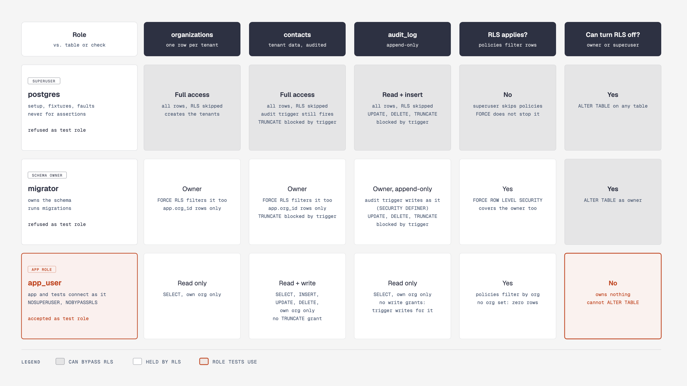
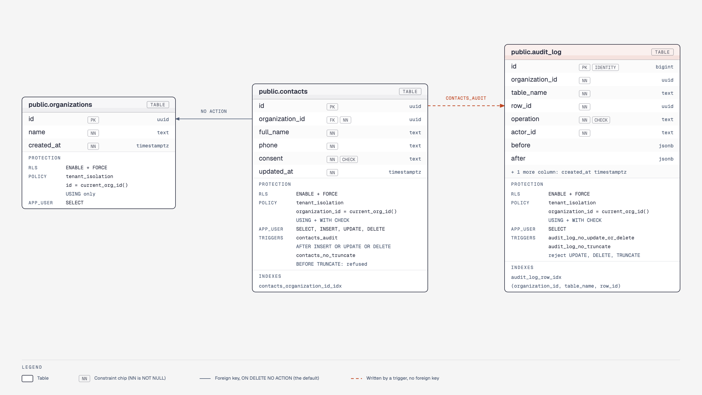
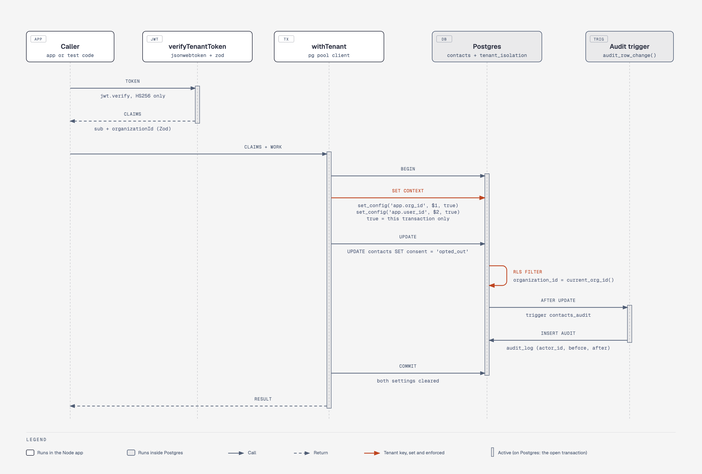
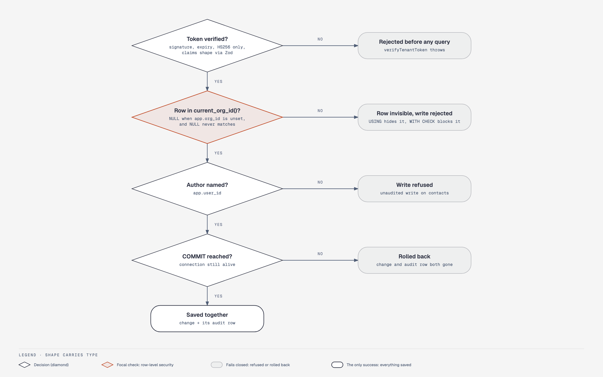
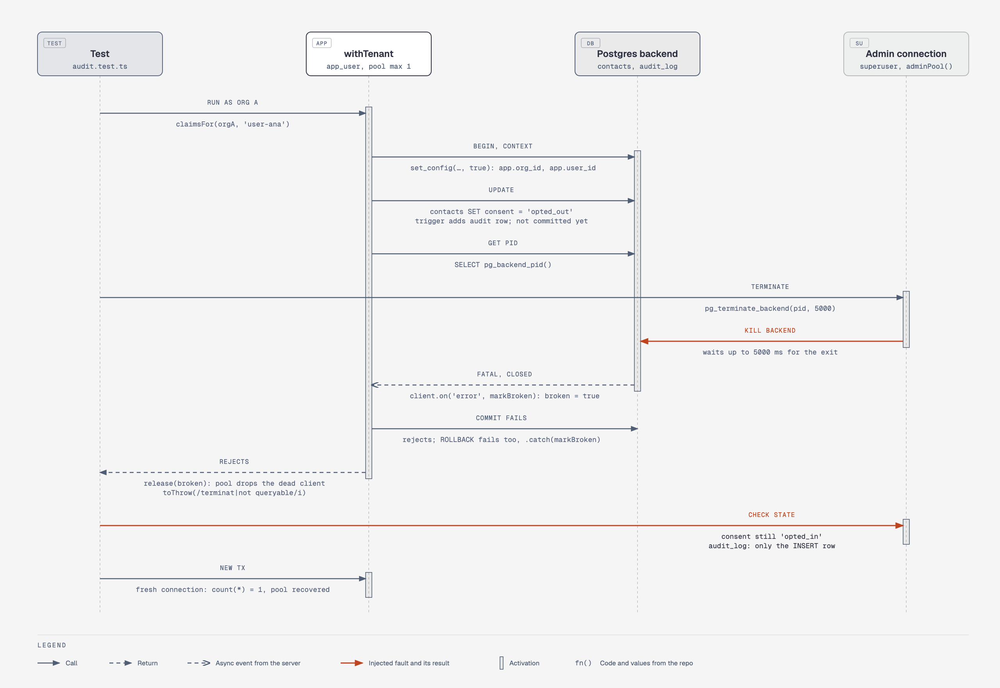
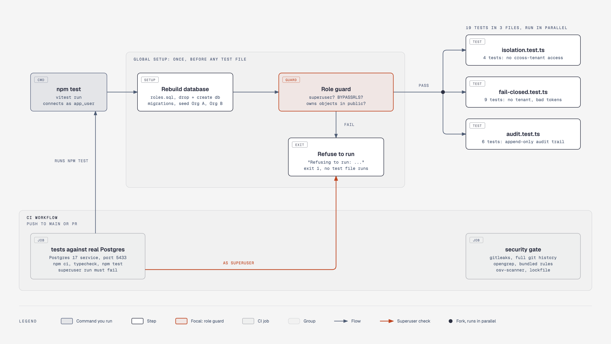

# Diagrams

One diagram per step of the build. Each PNG is exported from the HTML file next to it; open the HTML in a browser for the sharp vector version with its caption.

## 1. How the repo was built, step by step

Eight steps, from a throwaway Postgres to CI. The tag on each step names the diagram below that covers it.

[HTML](01-build-steps.html)

## 2. Who can do what

The three database roles against each table. Only `app_user` is held by row-level security with no way to turn it off, which is why every test connects as it.

[HTML](02-roles.html)

## 3. The tables and what protects them

Every column with its real type, plus the policy, grants, triggers and indexes on each table. The dashed line is the audit trigger: it writes `audit_log` in the same transaction as the change.

[HTML](03-schema.html)

## 4. One request, from token to commit

The organization comes from the verified token, `withTenant` sets it for one transaction, Postgres filters every row by it, and the audit row is written before `COMMIT`.

[HTML](04-request.html)

## 5. Every failure ends in no

Four checks in order. Each one that fails stops the request with a refusal or a rollback; the only success saves the change and its audit row together.

[HTML](05-fail-closed.html)

## 6. Killing the connection mid-transaction

The fault-injection test: the connection is killed after the `UPDATE` and before `COMMIT`. Neither the change nor its audit row survives, and the pool recovers.

[HTML](06-fault-injection.html)

## 7. How the suite proves itself, locally and in CI

Every run rebuilds the database and checks its own role before any test runs. CI runs the suite, runs it again as a superuser to prove the guard refuses, and runs the security gate.

[HTML](07-tests-and-ci.html)
